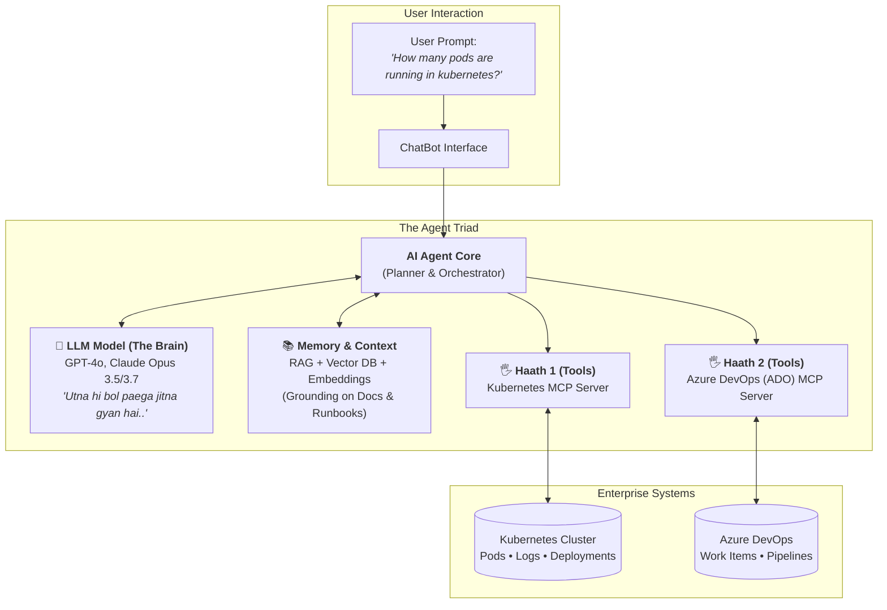

# 001. AI Yatra: Enterprise Agentic Architecture & Axion Systems

**Date:** June 21, 2026  
**Session:** AI Yatra — Foundation & Architecture  
**Product Reference:** `axionsystems.de`  
**Source Schematic:** [`diagram.pdf`](file:///c:/DevOpsInsiders/AgenticAIBatch1/agentic-ai-fde-batch-1/ClassNotes/001.AIYatra-AxionSystemsAI-21-06-2026/diagram.pdf)

---

## 1. Executive Summary & The Core Philosophy

### The Strategic Engineering Shift
> [!IMPORTANT]
> **"No need of building LLM Models, big companies are already doing it..."**  
> Frontier labs (OpenAI, Anthropic, Google, Meta) invest tens of billions of dollars pre-training massive foundation models. Attempting to build foundation models from scratch is capital and compute prohibitive for 99.9% of organizations.

### Where Real Enterprise Value & Compensation Lie (*"Paisa idhr milega mota"*)
High-leverage engineering and enterprise value creation exist in the **Agentic Application Layer**:
1. **AI Agents:** Goal-driven autonomous entities with memory and planning capabilities.
2. **Multi-Agent Orchestrators:** Stateful routing, coordination, and subagent delegation (LangGraph, AutoGen).
3. **Tool Integration via Standard Protocols:** Model Context Protocol (MCP), APIs, and real-time environment action.
4. **AI Governance & Security:** Guardrails, prompt injection defense, audit trails, and output validation.
5. **AI Gateways & Cost Optimization:** Unified routing, token caching, load balancing, and model tiering (e.g., LiteLLM).

---

## 2. Global Industrial Topology: Axion Systems (`axionsystems.de`)

The real-world industrial setup illustrated in the architecture represents **Axion Systems** operating across a distributed global infrastructure.

```
                    ┌──────────────────────────────────────────────┐
                    │            Product: axionsystems.de          │
                    │   Total: 27 Devices across 5 Global Sites    │
                    └──────────────────────┬───────────────────────┘
                                           │
         ┌───────────────┬─────────────────┼─────────────────┬───────────────┐
         ▼               ▼                 ▼                 ▼               ▼
   [EAST Refinery] [WEST Refinery] [NORTH Refinery]   [Central Plant]  [SOUTH Plant]
         │               │                 │                 │               │
      [Pumps]      [Compressors]       [Motors]           [Pumps]      [Compressors]
    (IoT Sensors)  (IoT Sensors)     (IoT Sensors)     (IoT Sensors)   (IoT Sensors)
         │               │                 │                 │               │
         └───────────────┴─────────────────┼─────────────────┴───────────────┘
                                           │
                                           ▼ Telemetry Stream
                          ┌──────────────────────────────────┐
                          │     Axion Ingestion Service      │
                          │      ingest.axionsystems.de      │
                          └────────────────┬─────────────────┘
                                           │
                                           ▼
                          ┌──────────────────────────────────┐
                          │        PostgreSQL Database       │
                          │   (Operational Telemetry & Logs) │
                          └──────────────────────────────────┘
```

### 2.1 Geographic Distribution & Assets
- **5 Global Sites:**
  - `EAST Refinery`
  - `WEST Refinery`
  - `NORTH Refinery`
  - `Central Plant`
  - `SOUTH Plant`
- **Asset Inventory:**
  - **Total Devices:** 27 monitored industrial assets worldwide.
  - **Equipment Types:** High-pressure Pumps (`Pump1`, `Pump2`), Industrial Compressors (`Compressor1`, `Compressor2`), and Electric Motors (`Motor1`, `Motor2`).
  - **Edge Instrumentation:** Every physical piece of equipment is equipped with dedicated **IoT Devices / Sensors** transmitting metrics (temperature, pressure, RPM, vibration).

### 2.2 Telemetry Ingestion Pipeline
- **Ingestion Gateway:** `ingest.axionsystems.de` captures streaming IoT sensor events.
- **Storage Layer:** Writes real-time telemetry into **PostgreSQL** for persistence, time-series analysis, and operational reporting.

---

## 3. The Anatomy of an AI Agent: Brain, Memory, and Hands

An LLM alone is purely cognitive but static. To be useful in an enterprise DevOps/SRE and operations environment, an AI Agent must possess three core pillars:



### 3.1 The Brain: The LLM Model
- **Examples:** GPT models, Claude Opus 3.5/3.7, Gemini.
- **Limitation:** *"Utna hi bol paega jitna gyan hai"* — A raw LLM cannot know how many pods are running in your cluster right now because that information is not in its training data cutoff. It has knowledge of general concepts, but zero access to private, dynamic, real-time runtime state.

### 3.2 The Memory: RAG, Embeddings & Vector DB
- **Components:** Vector embeddings, chunking algorithms, and Vector Databases (pgvector, Chroma, Qdrant).
- **Role:** Supplies the agent with proprietary runbooks, architectural documents, incident post-mortems, and internal organization context.

### 3.3 The Hands ("Haath"): Tools via Model Context Protocol (MCP)
To affect change or inspect infrastructure, an agent needs **"Hands" (Tools)**. Rather than writing proprietary, brittle one-off connectors, modern systems use **MCP (Model Context Protocol)** servers.

| Hand / Tool Interface | MCP Server | Capabilities / Functions Exposed to Agent |
| :--- | :--- | :--- |
| **Haath 1 (Infrastructure)** | **Kubernetes MCP Server** | • `Get pods`<br>• `Get Pods Logs`<br>• `Get Deployments`<br>• Describe cluster resources |
| **Haath 2 (CI/CD & Work Tracking)** | **Azure DevOps (ADO) MCP Server** | • `Get Work Items`<br>• `Get pipelines`<br>• Query pull requests & deployment runs |

---

## 4. End-to-End Execution Walkthrough: Operational Query

To understand how these components collaborate, consider the query highlighted in the schematic:

> **User Prompt:** *"How many pods are running in kubernetes?"*

```text
Step 1: Ingestion
  User enters the query into the ChatBot Interface.

Step 2: Intent & Reasoning (The Brain)
  The AI Agent forwards the prompt and tool registry definitions to the LLM.
  The LLM determines that it does not know the live cluster status from training weights alone.
  It recognizes that the "Kubernetes MCP Server" exposes a "Get pods" function.

Step 3: Tool Invocation (The Hands / Haath 1)
  The agent issues a structured Tool Call:
  {"tool": "kubernetes_mcp.get_pods", "parameters": {"namespace": "all"}}

Step 4: Tool Execution
  The Kubernetes MCP Server connects securely to the Kubernetes API server,
  runs the query, and returns the live list of pods across namespaces.

Step 5: Synthesis & Response
  The AI Agent passes the raw tool output back to the LLM.
  The LLM formats a human-friendly response:
  "There are currently 42 pods running across 4 namespaces (12 in production, 8 in staging, 22 in kube-system)."
```

---

## 5. Strategic Takeaways for Engineers & FDEs

1. **Do not reinvent foundation models:** Leverage state-of-the-art hosted and open-weights models through unified gateways like LiteLLM.
2. **Master Tooling & Protocols (MCP):** Standards like the Model Context Protocol decouple agent brains from the underlying tools, making integrations reusable across AI systems.
3. **Bridge Physical & Digital with IoT + AI:** Enterprise telemetry (from plants like `axionsystems.de` to K8s clusters) requires robust ingestion pipelines paired with agentic query interfaces.
4. **Develop Multi-Agent Orchestration:** Shift from single-turn chat prompts to multi-agent architectures where specialized agents handle diagnostics, triage, code changes, and verification.

---

## 6. Action Items & Self-Check

- [x] Understand why foundation model training is separate from enterprise agent building.
- [x] Trace how `ingest.axionsystems.de` connects 27 industrial assets across 5 locations to PostgreSQL.
- [x] Explain the "Brain, Memory, Hands" triad of AI agents.
- [x] Implement hands-on MCP server configurations for infrastructure tooling (Kubernetes, ADO, GitHub).
