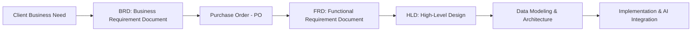
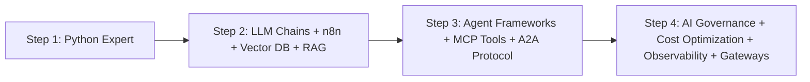

# 002. Introduction to Agentic AI & Engineering Paradigm Shift

**Date:** October 11, 2026  
**Session:** 002  
**Batch:** Agentic AI & FDE – Batch 1  
**Source Reference:** [`diagram.pdf`](file:///c:/DevOpsInsiders/AgenticAIBatch1/agentic-ai-fde-batch-1/ClassNotes/002.IntroductionToAgenticAI-11-10-2026/diagram.pdf)

---

## 1. Executive Summary & Core Definitions

### What is a Large Language Model (LLM)?
- **Definition:** An LLM is a machine learning model trained on vast amounts of multimodal data (text, images, code, etc.).
- **Primary Capability:** Understands, reasons over, generates, and responds to human language (*"insani bhasha"*).
- **Agentic Shift:** Transitioning from passive text generation to **autonomous goal execution**, tool usage, multi-step reasoning, and integration with enterprise software systems.

---

## 2. Real-World Case Study: Industrial IoT & Coal-Based Thermal Power Plant

To understand how software, data engineering, and Agentic AI solve real-world problems, we examine a **Coal-Based Thermal Power Plant**.

```
[ Coal Supply ] ──> [ Bhatti / Boiler ] ──> [ High Pressure Steam ] ──> [ Turbine ] ──> [ Generator ] ──> [ Transmission Lines ]
                          │                                                 │
                     [ Chimney ]                                   [ Water Intake ]
                                                          (River / Pond / Cooling System)
```

### 2.1 Major Physical Components
1. **Boiler / Bhatti:** Combusts coal to produce superheated steam.
2. **Turbine:** Converts thermal and kinetic energy of steam into mechanical rotational energy.
3. **Coal Handling System:** Transports, crushes, and feeds coal into the combustion chambers.
4. **Water Cooling System:** Draws intake water from ponds/rivers to condense steam back into water.
5. **Generator:** Converts turbine rotation into electrical energy.
6. **Steam Pipes:** High-pressure transport conduits carrying steam between boiler, turbine, and condensers.

### 2.2 Critical Operational & Business Questions ("Dimag ke Sawal")
Operational decision-makers need real-time answers to mission-critical questions:
- **Generation Output:** *How much electricity is the plant generating right now?*
- **Asset Health & Telemetry:** *What is the current health condition of the boiler, turbine, and steam lines?*
- **Resource Consumption:** *What is the current rate of coal and water consumption?*
- **Financial Unit Economics:** *What are the per-unit electricity generation costs and tariff margins?*
- **Predictive Anomaly Detection:** *Is any critical component overheating or exceeding safe vibration thresholds?*
- **Risk Assessment:** *If a plant outage occurs, what will be the hourly/daily financial loss?*
- **Audit & Compliance:** *Automated generation of weekly, monthly, and regulatory compliance reports.*

---

## 3. Software Engineering & Enterprise Delivery Lifecycle

Transforming operational questions into an enterprise software product follows a structured software delivery methodology:



### 3.1 Business Requirements Document (BRD)
Captures high-level business objectives:
- **BR01 — Live Plant Monitoring:** Real-time telemetry visualization across all plant assets.
- **BR02 — Generation Efficiency:** KPI tracking comparing coal burned vs. megawatt-hours generated.
- **BR03 — Abnormal Sensor Alert:** Automated real-time alerts when temperatures, pressures, or vibrations breach thresholds.
- **BR04 — Financial Visibility:** Real-time cost modeling, per-unit economics, and loss predictions.
- **BR05 — Reporting and Audit:** Automated generation and scheduling of operational reports.

### 3.2 Commercial & Functional Phase
- **Purchase Order (PO):** Contractual signoff and budget allocation.
- **Functional Requirement Document (FRD):** Authored by the Product Owner (FRD01, FRD02, FRD03, FRD04) breaking business rules into granular feature specifications.
- **High-Level Design (HLD):** Architectural design, service boundary definitions, and data contracts.
- **Data Modeling & Storage Design:** Schemas for timeseries metrics, sensor streams, and relational metadata.

---

## 4. The Engineering Paradigm Shift: Datacenter vs Cloud vs AI Agents

The industry has undergone fundamental shifts in team sizing, time-to-market, and economics:

| Era / Model | Team Size | Timeline | Total Project Expense | Developer Compensation (Ceiling) | Characteristics |
| :--- | :--- | :--- | :--- | :--- | :--- |
| **Axion Systems — Datacenter** | ~50 Engineers | ~2 Years | **₹5.0 Crore** | Max ₹24L – ₹25L | Heavy manual infrastructure, on-prem hardware provisioning, large operational overhead. |
| **Axion Systems — Cloud** | ~35 Engineers | ~1 Year | **₹2.5 Crore** | Max ₹60L – ₹70L | Cloud elasticity, managed services (PaaS/IaaS), increased individual leverage. |
| **Axion Systems — AI Agents + FDE** | **~15 Engineers** (AI Team + FDEs) | **~5 Months** | **₹1.5 Crore** | **₹1.0 Crore+ (FDE)** | Forward Deployed Engineers (FDEs) leveraging Agentic AI workflows; 10x velocity, hyper-compressed delivery schedules. |

> [!IMPORTANT]
> **Key Insight:** Teams are shrinking in headcount while increasing exponentially in capability. Forward Deployed Engineers (FDEs) who master Agentic AI command the highest market compensation because they deliver projects in **5 months for ₹1.5 Cr** instead of **2 years for ₹5 Cr**.

---

## 5. Technical Architecture: NextOps Smart Plant Platform

The NextOps platform demonstrates a scalable 3-Tier and microservices architecture powered by AI and streaming telemetry:

```
[ Sensors on Boilers, Turbines, Generators, Pipes ]
                        │
                        ▼ (Telemetry / Events)
             [ IoT Hub / Event Hub ]
                        │
                        ▼
       [ nextops-ingestion-service ]  (Python / Java / .NET / Go)
         https://ingest.nextops.live
                        │
                        ▼
             [ PostgreSQL Database ]  (Relational & Time-Series Data)
                        ▲
                        │
       [ nextops-query-service ]      (Python / Java / .NET / Go)
         https://api.nextops.live
             (With Agentic AI Layer)
                        ▲
                        │
       [ nextops-dashboard ]          (Next.js / React)
         https://dashboard.nextops.live
```

### 5.1 Service Breakdown
1. **IoT / Event Ingestion Layer:**
   - **Service:** `nextops-ingestion-service` (`https://ingest.nextops.live`)
   - **Stack:** Python, Go, Java, or .NET
   - **Role:** High-throughput ingestion of continuous telemetry from IoT sensors attached to plant equipment.
2. **Data Persistence Layer:**
   - **Database:** PostgreSQL
   - **Role:** Central source of truth for telemetry logs, historical timeseries, configuration, and audit records.
3. **Query & Agentic Processing Layer:**
   - **Service:** `nextops-query-service` (`https://api.nextops.live`)
   - **Stack:** Python, Go, Java, or .NET + Agentic frameworks (LangChain / LangGraph)
   - **Role:** Exposes REST/GraphQL APIs, executes analytical queries, and coordinates AI agents to reason over plant data.
4. **Presentation & User Experience Layer:**
   - **Service:** `nextops-dashboard` (`https://dashboard.nextops.live`)
   - **Stack:** Next.js / React
   - **Role:** High-performance responsive dashboard for real-time monitoring, alerts, financial reporting, and interactive agent queries.

### 5.2 Engineering Responsibility Spectrum
- **L1 Scope:**
  - Infrastructure Deployment (Cloud/Kubernetes/Containers)
  - Application & Product Deployment (CI/CD, environment management)
- **L2 Scope (FDE & Advanced AI Engineering):**
  - Data Engineering & Pipeline Design
  - System and Product Design (HLD/LLD)
  - Advanced Python Expertise
  - Agentic AI Architectures (LangChain, LangGraph, tool calling, memory, multi-agent workflows)

---

## 6. Enterprise Agentic AI Roadmap

To progress from standard software engineering to an elite Forward Deployed Engineer in AI, follow the 4-step roadmap:



### **Step 1: Python Expert**
- Master modern Python (async programming, typing, data structures, performance optimization).
- Deep understanding of APIs, data processing libraries, and backend frameworks.

### **Step 2: LLM Chains + Workflow Automation + Vector DB + RAG**
- LLM prompt chaining and structured outputs.
- Workflow automation platforms (e.g., **n8n**).
- Vector databases (Pinecone, Chroma, pgvector, Qdrant) for dense embeddings.
- Retrieval-Augmented Generation (RAG) pipelines for grounding models with private enterprise data.

### **Step 3: Agent Frameworks + MCP Tools + A2A Protocol**
- Advanced Agentic frameworks: **LangChain** and **LangGraph** (stateful multi-actor graphs).
- **Model Context Protocol (MCP):** Standardized tool integration allowing agents to interact with databases, GitHub, filesystem, and external APIs.
- **Agent-to-Agent (A2A) Protocols:** Inter-agent communication, delegation, and multi-agent coordination.

### **Step 4: Enterprise AI Governance, Observability & Gateways**
- **AI Governance & Compliance:** Guardrails, safety checks, output validation, RBAC.
- **AI Cost Optimization:** Token budgeting, caching strategies, model tiering (SLMs vs. frontier models).
- **Agent Observability:** Tracing agent reasoning loops, tool call latencies, and evaluations (LangSmith, Langfuse, OpenTelemetry).
- **AI Gateways:** Reverse proxying, fallback handling, load balancing, rate limiting (e.g., **LiteLLM**).

---

## 7. Hands-on Project Architecture: "Pappa RAG Project" & Multimodal Evolution

### 7.1 Web Scraping RAG Pipeline
An enterprise RAG pattern for automated knowledge ingestion:
- **User Input:** Enter target website URL (e.g., `devopsinsiders.com`, `infosys.com`, `tcs.com`, `chotaweb.in`).
- **Crawler / Extractor:** Automatically scrapes the entire textual and structural content of the website.
- **Chunking & Vectorization:** Text is chunked, converted into vector embeddings, and stored in a Vector Database.
- **Embedded Custom Chatbot:** Generates an embeddable widget (e.g., `di.embed.chat`, `chotaweb.embed.chat`, `embedyour.chat`) capable of answering domain questions with source attribution.

### 7.2 Multimodal Agentic Progression
The evolution path of Agentic capabilities:
1. **Agentic AI with Text:** Reasoning, summarizing, query translation, and text-based tool execution.
2. **Agentic AI with Photos / Vision:** Inspecting industrial diagrams, reading sensor gauge images, visual defect detection, and OCR.
3. **Agentic AI with Audio / Voice:** Voice-based plant floor assistant, acoustic anomaly detection (listening to turbine noise for abnormal frequencies), real-time conversational operators.

---

## 8. Summary Checklist & Action Items

- [x] Review plant telemetry and 3-tier IoT architecture.
- [x] Understand BRD to FRD to HLD product development progression.
- [x] Internalize the economic value proposition of the 15-member AI agent team / FDE model.
- [x] Begin Step 1 & Step 2 mastery: Python proficiency, RAG architecture, and Vector DBs.
- [x] Prepare for LangGraph, MCP tools, and LiteLLM AI Gateway integration in subsequent sessions.
