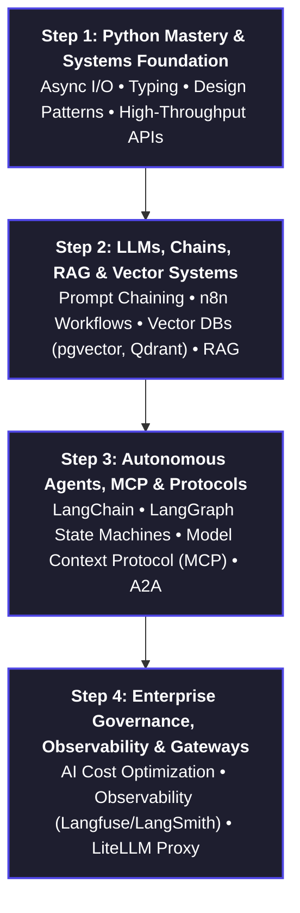

# Agentic AI & Forward Deployed Engineering (FDE) — Batch 1

<p align="center">
  
  
  
  
  
  
</p>

---

## 📌 Executive Overview

Welcome to the central repository for **Agentic AI & Forward Deployed Engineering (FDE) — Batch 1**, hosted by **DevOps Insiders**.

This repository is an enterprise-grade knowledge base, code registry, and lab laboratory designed to take engineers through the paradigm shift of building high-velocity, production-grade autonomous agent systems, multimodal architectures, and mission-critical enterprise applications.

> [!NOTE]
> **The FDE Advantage:** The modern engineering landscape is pivoting from legacy 50-engineer datacenter teams to nimble **15-person AI-augmented engineering squads**. Forward Deployed Engineers (FDEs) leverage Agentic workflows, MCP tools, and robust observability to deliver high-impact systems in months instead of years.

---

## 🗂️ Repository Structure

```text
agentic-ai-fde-batch-1/
├── 📁 Assignments/             # Hands-on challenges, design tasks & lab submissions
├── 📁 ClassNotes/              # Comprehensive lecture notes, diagrams & architectural briefs
│   └── 📁 001.IntroductionToAgenticAI-11-10-2026/
│       ├── diagram.pdf         # Architecture & curriculum source schematic
│       └── notes.md            # Detailed technical lecture notes & breakdown
├── 📁 CodeSamples/             # Production snippets, starter templates & utility scripts
├── LICENSE                     # Open source license
└── README.md                   # Repository index & documentation
```

### Quick Links
- [📂 Assignments](file:///c:/DevOpsInsiders/AgenticAIBatch1/agentic-ai-fde-batch-1/Assignments)
- [📂 Class Notes](file:///c:/DevOpsInsiders/AgenticAIBatch1/agentic-ai-fde-batch-1/ClassNotes)
- [📂 Code Samples](file:///c:/DevOpsInsiders/AgenticAIBatch1/agentic-ai-fde-batch-1/CodeSamples)
- [📄 Session 001 Notes](file:///c:/DevOpsInsiders/AgenticAIBatch1/agentic-ai-fde-batch-1/ClassNotes/001.IntroductionToAgenticAI-11-10-2026/notes.md)

---

## 🗺️ Master Curriculum Roadmap

Our learning path spans from fundamental systems mastery to multi-agent production governance:



| Phase | Milestone | Key Technologies | Core Competencies |
| :--- | :--- | :--- | :--- |
| **Step 1** | **Python Expert** | Python 3.11+, Pydantic, FastKafka/FastAPI | Systems programming, async execution, clean data contracts |
| **Step 2** | **Chains + Vector DB + RAG** | n8n, pgvector, Chroma, Qdrant, OpenAI/Anthropic APIs | Semantic search, knowledge graph grounding, pipeline automation |
| **Step 3** | **Agent Frameworks & Tooling** | LangChain, LangGraph, MCP, A2A Protocol | Stateful multi-agent loops, dynamic tool calling, autonomous recovery |
| **Step 4** | **Enterprise Governance & Gateways** | LiteLLM, Langfuse, LangSmith, Guardrails AI | Token budgeting, rate-limiting, agent tracing, audit compliance |

---

## 📚 Session Catalog & Learning Log

| Session ID | Date | Topic | Key Deliverables | Status |
| :---: | :---: | :--- | :--- | :---: |
| **001** | 11-10-2026 | **Introduction to Agentic AI & Engineering Paradigm Shift** | • [Session 001 Notes](file:///c:/DevOpsInsiders/AgenticAIBatch1/agentic-ai-fde-batch-1/ClassNotes/001.IntroductionToAgenticAI-11-10-2026/notes.md)<br>• [Architecture Diagram](file:///c:/DevOpsInsiders/AgenticAIBatch1/agentic-ai-fde-batch-1/ClassNotes/001.IntroductionToAgenticAI-11-10-2026/diagram.pdf)<br>• Thermal Power Plant IoT Study<br>• Team Economics & FDE Model | Completed ✅ |
| **002** | *TBA* | **Advanced Python & Async Workflows for AI Engineers** | • Code samples & API contracts | Scheduled ⏳ |
| **003** | *TBA* | **Vector Databases & Production RAG Pipelines** | • Autonomous web-scraper knowledge ingestor | Scheduled ⏳ |
| **004** | *TBA* | **Multi-Agent Orchestration with LangGraph & MCP** | • Stateful graph agents & tool protocol | Scheduled ⏳ |

---

## 🛠️ Technology Stack & Architecture

```
[ Edge Sensors / Users ] ──> [ Ingestion Gateway ] ──> [ Postgres / Vector Store ]
                                                              │
                                                              ▼
[ Next.js Dashboard ] <────> [ AI Agent Core (LangGraph) ] <───┘
```

- **Frontend & Visualization:** Next.js, React, Tailwind CSS
- **Backend & Ingestion:** Python, Go, FastAPI, IoT Hubs
- **Data & Vector Storage:** PostgreSQL (`pgvector`), Redis
- **AI Agent Orchestration:** LangGraph, LangChain, MCP (Model Context Protocol)
- **Gateways & Telemetry:** LiteLLM Proxy, LangSmith, Langfuse

---

## 🤝 Community & Support

For queries related to sessions, labs, and assignments:
- **Instructor / Lead:** Ashish Sir
- **Community:** DevOps Insiders — Agentic AI Cohort
- **Direct WhatsApp Inquiries:** `+91 7632 001 357`

---

<p align="center">
  <i>Built with focus and rigor for the next generation of Forward Deployed Engineers. 🚀</i>
</p>
